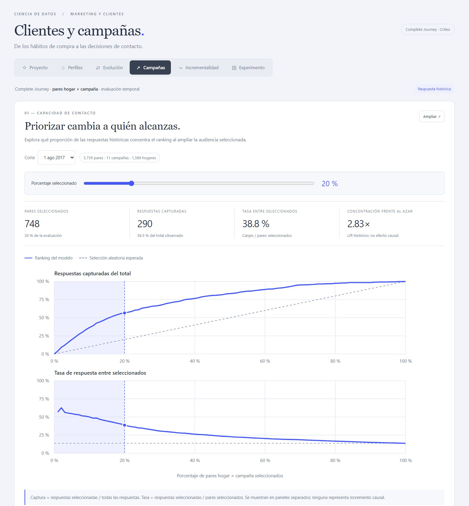

# Customer Growth Intelligence

**Analítica de crecimiento de clientes**: propensión de respuesta, segmentación de
comportamiento, diseño y análisis de experimentos de campaña, y auditoría de
*uplift*. Tres piezas del portafolio, antes separadas, consolidadas en un solo
repositorio con su pipeline, su tablero y sus artefactos de evidencia.

[](https://github.com/Dev-HugoAguilar/customer-growth-intelligence/actions/workflows/tests.yml)
[](https://www.python.org/)
[](#datos-y-atribución)

> **Alcance.** Analítica sobre cohortes de clientes, no un CRM ni un motor de
> campañas. Los experimentos se diseñan y se analizan; no se ejecutan envíos
> reales. Los conjuntos de datos de terceros no se redistribuyen: se documenta su
> origen y cómo obtenerlos.

---

## Tres proyectos, un repositorio

| Origen | Qué aporta | Dónde vive aquí |
|---|---|---|
| `marketing_customer_project` | Propensión robusta, segmentación K-Means, diseño y análisis ITT de campañas, auditoría del dataset Criteo | `pipeline/` |
| `clientes-campanas` | Tablero integrado de clientes y campañas con sus artefactos publicados | `dashboard-campanas/` |
| `clientes-en-movimiento` | Tablero semanal publicado sobre la misma capa de datos | `dashboard-en-movimiento/` |

La consolidación es deliberada: los tres comparten cohorte, unidades y decisiones
de lectura. Tenerlos separados obligaba a duplicar la definición de hogar, de
segmento y de *uplift*; juntos, la documentación es una sola y las pruebas cubren
los tres frentes.

## Demo

El tablero integrado se sirve sin compilación:

```bash
git clone https://github.com/Dev-HugoAguilar/customer-growth-intelligence.git
cd customer-growth-intelligence
python -m http.server 8000 --directory dashboard-campanas/app
```

Abre <http://127.0.0.1:8000/>. El tablero semanal se abre igual apuntando a
`dashboard-en-movimiento`.



## Pipeline analítico

```bash
python -m pip install -r requirements-dev.txt
python -m pytest
```

Las **18 pruebas** cubren las dos familias de artefactos:

- **Tablero**: reconciliación de tamaños, conservación de flujos, curvas que
  terminan en el universo, separación de fuentes y reproducción del cálculo de
  potencia.
- **Plantillas**: el aleatorizador no puede afirmar aleatorización y rechaza
  estratos diminutos; el analizador ITT exige manifiesto, rechaza una bandera sin
  evidencia y aplica la corrección de Holm.

### Qué hay en `pipeline/src`

| Módulo | Función |
|---|---|
| `response_propensity.py` | Modelo de propensión de respuesta con validación temporal. |
| `robust_propensity_validation.py` | Robustez del modelo entre cortes y semillas. |
| `behavior_segments.py` | Segmentación K-Means alineada por hogar entre cortes. |
| `validate_behavior_segments.py` | Validación de estabilidad de los segmentos. |
| `plan_segment_campaign_experiment.py` | Cálculo de potencia y plan de tamaño. |
| `randomize_segment_campaign_trial.py` | Aleatorización con manifiesto y guardas. |
| `evaluate_segment_campaign_trial.py` | Análisis ITT con corrección de Holm. |
| `uplift_baseline.py` | Referencia de *uplift* y curvas de ganancia. |
| `audit_criteo_uplift.py` | Auditoría de viabilidad del dataset Criteo. |
| `criteo_full_reference_benchmark.py` | Benchmark contra la referencia completa. |
| `export_dashboard*.py` | Exportación de artefactos del tablero y del corte semanal. |

## Decisiones metodológicas

- **La cohorte manda.** El corte activo es 2017-09-01, sobre 90 días desde el
  3 de junio de 2017, del conjunto Complete Journey.
- **Segmentos alineados por hogar.** K-Means con k=2 se alinea entre cortes por
  hogar, no por número de clúster: el nombre del segmento no puede cambiar de
  significado entre periodos.
- **Aleatorización verificable.** El aleatorizador escribe un manifiesto con la
  semilla, los estratos y los tamaños; el análisis exige ese manifiesto y rechaza
  tratar una bandera como prueba de aleatorización.
- **Multiplicidad declarada.** El análisis ITT aplica corrección de Holm y la
  reporta; no se presentan comparaciones múltiples sin ajuste.
- **Uplift con escepticismo.** La auditoría del dataset Criteo decidió qué se
  podía afirmar y qué no; el benchmark se repite con varias semillas para
  distinguir señal de ruido.
- **Sin datos crudos en el repositorio.** Se publican agregados, artefactos de
  paridad y resultados; los conjuntos de origen se descargan aparte.

## Estructura

```text
pipeline/src/            Módulos analíticos
pipeline/tests/          Pruebas de artefactos y de plantillas
pipeline/reports/        Resultados: validaciones, benchmarks y decisiones
pipeline/requirements.txt
dashboard-campanas/app/    Tablero publicable (index.html + data/)
dashboard-campanas/src/    Plantilla, estilos y scripts del tablero
dashboard-campanas/paridad/  Artefactos de paridad y contraste
dashboard-en-movimiento/   Tablero semanal publicado
docs/                    Metodología, proyecto integrado y límites
```

El constructor del tablero (`construir.py`) realiza una **verificación de paridad
byte a byte** contra los artefactos de referencia y está atado al layout del
monorepo de origen; se conserva allí. Este repositorio publica el tablero ya
construido y los artefactos que lo respaldan, para que la demo funcione sin
reconstruir nada.

## Datos y atribución

- **Complete Journey** (Dunnhumby): cohorte de hogares y transacciones. No se
  redistribuye; ver [`docs/DATOS.md`](docs/DATOS.md).
- **Criteo Uplift Prediction**: muestra de 500 mil y de 100 mil filas. No se
  redistribuye; se documenta su descarga y el procedimiento de auditoría.

Este repositorio no incluye un archivo `LICENSE` propio: se respetan las
condiciones de cada fuente.

## Límites

- Los resultados dependen de la cohorte y del corte; no son una verdad general
  sobre propensión ni sobre *uplift*.
- Los segmentos son descriptivos, no causales.
- Un experimento diseñado aquí no sustituye una prueba en producción con
  seguimiento de exposición real.
- El tablero muestra agregados: no expone hogares individuales identificables.

## Contribuir y seguridad

Convenciones en [`CONTRIBUTING.md`](CONTRIBUTING.md). Para reportar un problema,
usa los avisos privados de [`SECURITY.md`](SECURITY.md).
